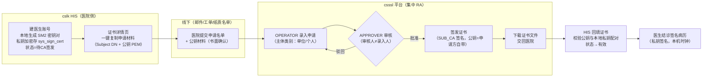
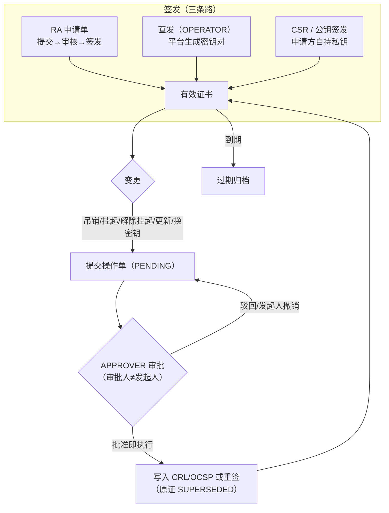

# csssl · CA 认证中心（多租户）

面向 HIS 生态的独立证书认证中心：为多家医院提供**独立信任域（每租户一把根CA）**，并作为平台集中 RA，代医院完成证书的录入、审核、签发与全生命周期管理。

- **CA 认证**：根CA初始化（RSA2048 / SM2 国密）、二级CA（SUB_CA）签发、证书签发、CRL（全量+增量）、证书链校验、OCSP 三态查询
- **多租户**：每家医院独立根CA + SUB_CA + 密钥域 + 审计与数据隔离（`tenant_key` 服务端强制过滤，不信任前端传参）
- **平台集中 RA + 线下人工中转**：医院不登录系统，只提交申请名单；医生签名证书由平台操作员录入、审核员复核后签发（双人分离）。**与 HIS 之间无任何在线发证接口**
- **分权制衡**：证书的全部写操作（吊销/挂起/更新/换密钥）走**操作单双人复核**；系统管理员 ADMIN 权限全收，只管人工信息（账号/角色/租户档案），业务台账只读

## 架构位置

```
┌────────────────────┐        线下人工中转（申请名单 / 申请材料 / 证书文件）        ┌──────────────────┐
│ cslk HIS            │ ──────────────────────────────────────────────────────► │                  │
│ (医生签名证书, 8080) │   HIS 侧生成密钥对（软签）或 UKey（硬签，私钥不出设备）      │  csssl CA认证中心  │
└────────┬───────────┘                                                         │  (本工程, 8092)   │
         │                                                                     │  根CA/SUB_CA/     │
         │ HTTP：信任根/CRL/OCSP 公开拉取（在线）                                 │  RA/CRL/OCSP/审计  │
         ▼                                                                     └────────▲─────────┘
┌────────────────────┐   证书信任链 / mTLS（证书由 csssl 签发）                            │
│ csmig 医保前置等     │ ────────────────────────────────────────────────────────────────┘
└────────────────────┘
```

## 技术栈

- 后端：Spring Boot 3.2.5 / Java 21 / MyBatis-Plus / MySQL（库：`ssl_ca`）
- 证书：BouncyCastle，X.509 v3，支持 RSA2048 与 SM2（SM3withSM2）
- 前端：Vue 3 / Vite / Element Plus 管理后台（端口 5175，代理 `/ssl` → 8092）
- 鉴权：SM2 口令加密传输 + BCrypt 存密 + JWT 会话；改密/改角色/停用即吊销全部旧会话
- 私钥存储：平台自有密钥 SM4 加密落库 `ssl_key_vault`（KEK 走 `SSL_MASTER_KEY`/master.key，有意不入库）；**医生私钥永不入库**——申请方自持是合规红线

## 核心流程

### 1. 医生签名证书：线下人工中转（已定边界，无在线对接）



要点：

- **私钥永不离开申请方**：软签场景私钥在 HIS 本地加密存储；硬签场景私钥在 UKey 芯片内生成不出设备。CA 只接触公钥，碰私钥 = 不可抵赖性破产
- **证书 DN 只放稳定身份**：`CN=姓名, O=机构（受租户域控制）, OU=选填（员工编号等不变信息）`；科室等易变属性不进 DN，科室授权由 HIS 业务层判断
- **不采集医生身份证号**、不建医生账号；平台只留台账（主体/公钥/有效期/状态）
- HIS 侧使用形态：登录后查本地是否有有效签名证书（查 HIS 不查 CA），无证则结诊后不能写病历
- 时间戳：HIS 签名一律用本机时钟；csssl 的 TSA 服务保留但为可选项

### 2. 证书生命周期与操作单双人复核



- 直接执行端点已**全部拆除**：吊销/挂起/解除挂起/更新/换密钥含 ADMIN 在内一律走单
- 硬校验：同证书同类型仅一张 PENDING、执行前重验证书状态、吊销/挂起必填原因、更新/换密钥必填新有效期、换密钥提交时即校验私钥在库（fail early）、根CA不走单

## 目录结构

```
csssl/
├── source/
│   ├── ssl_backend/          # 后端（Spring Boot，端口 8092，context-path /ssl）
│   │   └── src/main/
│   │       ├── java/com/csssl/
│   │       │   ├── controller/    # auth / admin/{users,roles,tenants,ca,certs,cert-ops,applications,templates,crl,audit} / ca/public / tsa
│   │       │   ├── service/       # CaService CertService CertApplicationService CertOpTicketService CrlService VerifyService OcspService TenantService ...
│   │       │   ├── util/          # CertUtil KeyVault Sm2Util Sm4Util PemUtil JwtUtil TenantScope
│   │       │   ├── entity/ enums/ mapper/ dto/ config/ common/
│   │       │   └── CssslApplication.java
│   │       └── resources/db/schema.sql   # 幂等建表脚本（手工执行，启动零 DDL）
│   └── front/                # 管理后台（Vite 端口 5175）
│       └── src/views/        # Dashboard / Applications / Certs / Crl / Ocsp / RootCa / Tenants / Templates / Users / Roles / Audit / Tsa
├── docs/                     # 使用手册、厂商差距分析、KMC 豁免声明等
└── README.md
```

## 快速启动

前置：MySQL（账号密码可用环境变量覆盖），JDK 21，Node 18+。

```bash
# 1. 首次：手工在库执行建表脚本（幂等可重复跑；系统启动不执行任何 DDL）
mysql -h <host> -u <user> -p ssl_ca < source/ssl_backend/src/main/resources/db/schema.sql

# 2. 后端
cd source/ssl_backend
mvn spring-boot:run          # http://localhost:8092/ssl

# 3. 前端
cd source/front
npm install
npm run dev                  # http://localhost:5175
```

启动时自动完成（**全部幂等：缺了才建，已有即复用，重启绝不覆盖**）：

1. 铺行数据：预置角色、`admin / 123456`、内置证书模板、过期扫描（DataInitializer，只铺行不建表）
2. 各租户根CA + SUB_CA：仅当无根记录且无私钥时才生成；已有则加载复用。唯一重建场景：根私钥丢失（吊销旧根重建新链，需主动触发「初始化根CA」）

> 生产必须注入 `SSL_MASTER_KEY`（32位十六进制 SM4 主密钥）。开发期未配置时首启随机生成落盘 `master.key`。私钥密文统一存 `ssl_key_vault` 表；密钥目录 `store-dir/tenants/{tenantKey}/` 存证书/CRL/根密钥份额。

## 核心 API

### 业务系统公开接口（无需登录，`/ssl/ca/public`）

| 接口 | 说明 |
|---|---|
| `GET /ca/public/root` · `/subca` | 主租户根证书 / SUB_CA 证书 PEM |
| `POST /ca/public/verify` | 证书链在线校验（叶子→SUB_CA→根逐级验签/有效期/吊销/用途） |
| `GET /ca/public/crl` · `/crl/delta` | 全量 CRL / 增量 CRL（dCRL）下载 |
| `POST /ca/public/ocsp` · `GET /ca/public/ocsp/{b64url}` | OCSP 三态查询（good/revoked/unknown，RFC 6960） |
| `/ca/public/{tenantKey}/…` | 上述全部接口的按租户域变体（root/subca/verify/crl/crl/delta/ocsp） |

### RA 申请单（`/ssl/admin/applications`）

| 接口 | 说明 |
|---|---|
| `GET` · `GET /{id}` | 申请单列表/详情 |
| `POST` | 提交申请（主体类别：单位/个人；DN=CN+O+OU选填；公钥由申请方自带或平台代生成） |
| `POST /{id}/approve` · `/reject` · `/issue` | 审核→批准/驳回→签发（审核人≠录入人） |
| `POST /{id}/cancel` | 撤销（仅提交人本人，ADMIN 也不行） |

### 证书与操作单

| 接口 | 说明 |
|---|---|
| `GET /admin/certs` · `/{id}` | 证书列表/详情（含 keyHeld 私钥是否在库） |
| `POST /admin/certs` | 直发签发（OPERATOR，平台生成密钥对） |
| `POST /admin/certs/csr` | CSR 签发（申请方自持私钥） |
| `POST /admin/certs/public-key` | 公钥签发（RA 主通道，收公钥代录） |
| `GET /admin/certs/{id}/cert.pem` | 下载证书（叶子+SUB_CA 完整链） |
| `GET /admin/certs/{id}/key.pem` | 下载私钥（仅 KEY_ADMIN + 开关控制，仅平台代生成场景有） |
| `POST /admin/certs/{id}/export/p12` | 导出 PKCS#12（口令不进访问日志） |
| `GET /admin/cert-ops` · `/{id}` | 证书操作单列表/详情 |
| `POST /admin/cert-ops` | 提交操作单（REVOKE/SUSPEND/UNSUSPEND/RENEW/REKEY） |
| `POST /admin/cert-ops/{id}/approve` · `/reject` · `/cancel` | 审批（批准即执行）/驳回/发起人撤销 |

> **吊销/挂起/解除挂起/更新/换密钥没有直接执行接口**——只能提交操作单，APPROVER 审批通过才执行。

### 租户 / CA 根 / CRL / 审计 / 系统管理

| 接口 | 说明 |
|---|---|
| `GET/POST /admin/tenants` · `/{key}/suspend\|resume\|close` | 租户注册与状态流转（开租户即建独立根CA+SUB_CA+门限份额；仅 TENANT_ADMIN/ADMIN 档案侧） |
| `GET /admin/ca/status` | 根CA状态（含 SUB_CA 与根密钥封存状态，`?tenantKey=` 切域） |
| `POST /admin/ca/init` | 初始化/重建根CA（幂等，私钥丢失时吊销旧根重建） |
| `POST /admin/ca/seal` · `/unseal` | 根私钥封存（离线化）/ 解封 |
| `GET/POST /admin/ca/shares*` | 根密钥 Shamir(3,5)：`/shares` 状态 / `/shares/migrate` 迁移 / `/shares/{index}` 下载份额 / `/unseal-shares` 3份解封 |
| `GET /admin/ca/root/download` · `/subca/download` | 导出根 / SUB_CA 证书 |
| `GET /admin/crl` · `/records` · `/download` · `/delta` | CRL 状态 / 吊销记录 / 下载 / 增量详情 |
| `GET /admin/audit` · `POST /verify` · `GET /chain-verify` · `GET /export` | 审计查询 / 验签 / 全链对账 / 归档导出（仅 AUDITOR） |
| `GET/POST /admin/templates` | 证书模板（内置 SERVER_COMM/DOCTOR_SIGN/SUB_CA；仅 SECURITY_ADMIN） |
| `GET/POST /admin/users` · `POST /admin/users/{id}` | 用户管理（仅 USER_ADMIN） |
| `GET/POST /admin/roles` · `/{code}/perms` 等 | 角色与权限管理 |
| `GET /admin/overview` | 概览统计 |
| `GET /auth/publicKey` · `POST /auth/login` · `/changePassword` · `/logout` | 登录链路（口令 SM2 密文；5 次失败锁定 15 分钟） |
| `POST /tsa/stamp` · `GET /tsa/publicKey` | 可选 TSA 时间戳服务（HIS 侧已改用本机时钟，此服务保留备用） |

## 角色与分权

三员分立 + 双人复核（GM/T 0034 §10.1g），内置角色：

| 角色 | 职责边界 |
|---|---|
| ADMIN 系统管理员 | **只管人工信息**（账号/角色/租户档案），业务台账只读；签发/审核/吊销/模板/根密钥一律不沾 |
| OPERATOR CA操作员 | 申请录入、直发签发、发起操作单 |
| APPROVER 审核员 | 审核申请单与操作单（不得与发起人同一人） |
| AUDITOR 审计员 | 审计查询/验签/归档，只读独立 |
| SECURITY_ADMIN 安全管理员 | 证书模板与策略（KeyUsage/EKU/策略OID） |
| KEY_ADMIN 密钥管理员 | 根密钥门限分持/封存/解封、私钥导出开关 |
| TENANT_ADMIN / USER_ADMIN / RA_ADMIN / CERT_OFFICER / AUDIT_ADMIN | 租户域管理 / 用户角色档案 / RA 流程配置 / 仅签发执行 / 审计策略（按需启用） |

权限每次请求从库现取（配置 ∩ 法定上限），改完即时生效、无需重登。

## 关键设计

- **多租户独立信任域**：每租户一把独立根CA + 专属 SUB_CA + 独立密钥目录（`store-dir/tenants/{tenantKey}/`）；租户间互不信任（A 域根验 B 域证书一律 valid=false）。主租户唯一（PRIMARY_TENANT_KEY），旧 `default` 域仅作存量路径兼容标识、不可新建。租户 SUSPENDED/CLOSED 只门禁写操作，历史证书仍可验证吊销
- **数据域服务端强制隔离**：业务表带 `tenant_key`，租户用户锁定本域（跨域读写 403，不信任前端传参）；全局账号需显式 `?tenantKey=` 才跨域
- **根CA离线化 + 门限分持**：根CA仅初始化与签发 SUB_CA，日常签发/CRL/OCSP 全由 SUB_CA 承担；根私钥推荐 Shamir(3,5) 门限分持（任 3 份恢复，份额是唯一持久形态），到期前自动轮换
- **私钥加密落库**：平台自有密钥 SM4 加密存 `ssl_key_vault`，旧密钥文件首访自动迁移；医生/申请方私钥永不入库
- **增量 CRL（dCRL）**：带 DeltaCRLIndicator，只发布自最近全量以来新增条目；CRL 按"吊销集合指纹"判重（内容未变不递增编号）；每日定时发布，依赖方全量+增量合并同步
- **审计链**：全部敏感操作落 `ssl_audit_log`，每条 SM3withSM2 签名 + SM3 哈希链（改一条即断链，删中间记录由链对账检出）；归档导出 CSV + 报告签名
- **启动零 DDL**：表结构只允许手工执行 `db/schema.sql`（幂等），启动不重建表结构；行数据由 DataInitializer 幂等播种
- **国密支持**：SM2 签发（sm2p256v1 / SM3withSM2）、SM4 对称加解密、SM2 口令加密传输，与 openssl 国密工具链互通

## 生产期配置建议

| 环境变量 | 说明 |
|---|---|
| `SSL_MASTER_KEY` | 私钥加密主密钥（32位十六进制），**生产必须注入**，多实例共享 |
| `SSL_PUBLIC_BASE_URL` | 对外可访问地址（生成证书 CDP/AIA 与 OCSP URL） |
| `SSL_ROOT_ALGORITHM` | 医保/卫健行业建议 `SM2`（国密） |
| `SSL_STORE_DIR` | 共享存储 + 严格文件权限；生产建议根私钥移入 HSM/加密机（GM/T 0018） |
| `SSL_ALLOW_KEY_DOWNLOAD` | 生产设为 `false` |
| `SSL_SM2_PRIVATE_KEY` / `SSL_SM2_PUBLIC_KEY` | 登录加密 SM2 密钥对，多实例必须显式配置同一对 |
| `SSL_JWT_SECRET` | 生产必须用环境变量覆盖 |
| 数据库账号 | `ssl_ca` 库最小权限，勿用管理员账号 |

## 合规提示

- 《电子签名法》第17/18条：面向公众发证须工信部许可——csssl 限院内/集团自用，**不可对外商用发证**
- 《密码法》第27条 + 《商用密码管理条例》第38/39条：服务的系统参与密评时，建议根私钥接入加密机并保持根CA离线
- KMC/双证书体系（加密证书托管）仅第三方持证 CA 强制，院内自用豁免声明见 `docs/院内证书策略与KMC豁免声明.md`

## 演进记录（已交付）

- [x] RA 申请-审核-签发双人审批 + 证书操作单双人复核（吊销/挂起/更新/换密钥直接执行端点全部拆除）
- [x] 多租户架构（机构 org → 租户 tenant 全量改造：表/接口/权限码/密钥目录/前端）
- [x] ADMIN 权限全收：只管人工信息，业务只读（三员分立）
- [x] 平台私钥 SM4 加密落库 ssl_key_vault（文件形态自动迁移）
- [x] 医生签名证书线下人工中转流程打通（HIS 造钥 → 平台代录代审代发 → 回填），无 HIS↔CA 在线发证接口
- [x] 根密钥 Shamir(3,5) 门限分持、根CA封存/解封、增量 CRL、审计签名+哈希链+归档、PKCS#12 导出
- [x] TSA 时间戳服务（HIS 侧已改用本机时钟，平台侧保留为可选）

## TODO（演进）

- [ ] 国密 UKey 发证（GM/T 0016 保护结构、私钥不出设备）——需硬件采购；硬签场景下医生 UKey 灌装流程待落地
- [ ] 服务器密码机 HSM 对接（GM/T 0018）——生产/密评立项
- [ ] 远程 RA 分节点 + SCEP/CMP 标准协议（GM/T 0089）
- [ ] 私钥导出（key.pem/P12）是否纳入双人复核——待拍板
